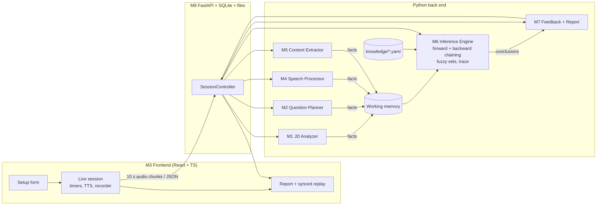
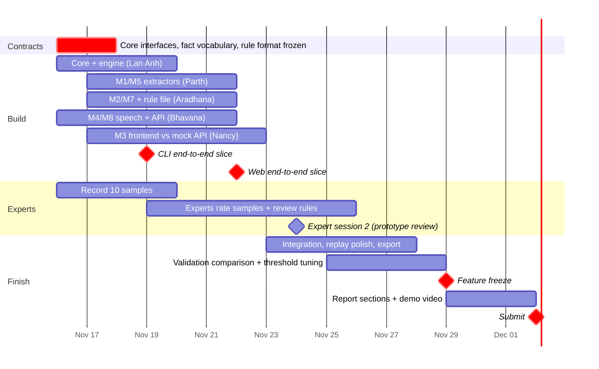

# STARlight — Implementation Plan

Status as of **Mon Nov 16, 2026**. Source of truth for scope: `STARlight - Project Milestone #2.pdf`.
Milestone #3 (working system, final report, demo video) is due **Wed Dec 2, 11:59 pm**.
Step-by-step build order: see `IMPLEMENTATION.md`. **Expert sessions are on hold**; validation falls back to blind ratings by team members who did not write the rules.

---

## 0. Where we are and what changes

| Planned (Milestone #2) | Reality on 11/16 | Consequence |
|---|---|---|
| Core interfaces frozen 11/11 | Repo has no code | Freeze **11/17** (this plan, §3–§4) |
| Sprint 1: modules standalone 11/9–15 | Not started | Sprint 1 and 2 merge into one week (11/16–22) |
| End-to-end slice by 11/18 | — | CLI slice **11/19**, web slice **11/22** |
| Expert session 2 + validation 11/23–29 | Expert statements only cover **Nov 5–25** | All expert work must finish by **11/25** |

**Most important scheduling point:** experts can rate the 10 sample recordings *without* our system being ready.
Record the samples and send them to the experts this week (by 11/19), so their ratings come back by 11/25.
We compare STARlight's ratings against them afterwards.

### Technical decisions (made from the research, override Milestone #2 where noted)

| # | Decision | Why |
|---|---|---|
| D1 | **Write our own engine; drop experta as a fallback** | experta 1.9.4 (2019) pins `frozendict==1.2`, which imports `collections.Mapping` (removed in Python 3.10). It cannot install on a current Python. |
| D2 | **Python 3.12** for the backend | Every dependency (faster-whisper/ctranslate2, spaCy 3.8, PyAV, pdfplumber) ships 3.12 wheels. 3.14 works too, but 3.12 is the safest common denominator for 5 laptops. |
| D3 | **One `MediaRecorder` per answer turn**, `timeslice = 10000` | Only the first WebM chunk carries the header, so chunks are not separately decodable. One recorder per turn keeps each turn a complete file. Chunks upload with a sequence number, and the server appends them in order; a failed upload is retried, so "lose at most one chunk" holds. |
| D4 | **Two-pass transcription** | Live pass: a fast model (`base.en`, int8, CPU) runs right after "Done answering" and feeds the follow-up decision (target ≤ 5 s). Post-session pass: `small.en` with word timestamps for the report. This is the "Priority" requirement made concrete. Final model choice comes from the day-1 benchmark (§6, task S1). |
| D5 | **Filler detection does not rely on plain Whisper alone** | Whisper deliberately drops "um/uh". Run 1: `initial_prompt` containing fillers ("Umm, let me think, uh, so...") plus counting long pauses from word-timestamp gaps. Stretch: CrisperWhisper (verbatim fine-tune, non-commercial licence, fine for a course). Report this as a known limitation to the experts. |
| D6 | **Rules reason only over facts** (unchanged) | Extractors (M1, M2, M4, M5) assert facts; M6 reasons; M7 reads conclusions. The **fact vocabulary (§4) is the contract** between teammates. |
| D7 | **No LLM in the reasoning path** | Grading is "expert system with explicit rules + explanations". Questions come from the YAML bank; feedback text comes from rules. |
| D8 | **Run locally for the demo** | FastAPI on `localhost:8000`, Vite dev server on `localhost:5173`. No deployment work. |

---

## 1. System at a glance



Session lifecycle (the four stages from Milestone #2):

1. **Planning:** JD text/PDF → M1 asserts `JD-CUE` / `TARGET-COMPETENCY`. M2 (R1–R4 + planning rules) picks N questions and per-question budgets.
2. **Live loop (per question):**
   ask (text + optional TTS) → record turn → **Done** → live transcription (M4) → content facts (M5) →
   forward chaining (answer-analysis + delivery rules) → R15 time check → backward chaining toward `(COMPLETE ?a)` →
   either ask the follow-up for the first unmet sub-goal (new turn, same question) or move on.
3. **Post-session analysis:** re-transcribe with the better model → re-extract facts → full forward chaining incl. rating and feedback rules (R17+).
4. **Review:** report with 4 ratings per answer, timestamped feedback, "Why this feedback?" (HOW + WHY NOT), synchronized replay, JSON/XML export.

---

## 2. Repository layout

```
STARlight/
├── PLAN.md                     ← this file
├── README.md                   ← setup + run instructions
├── backend/
│   ├── pyproject.toml          ← Python 3.12, deps, pytest, ruff
│   ├── starlight/
│   │   ├── core/               ← shared core: 14 classes (owner: Lan Anh)
│   │   │   ├── timespan.py     TimeSpan
│   │   │   ├── media.py        MediaObject, AudioClip, TextDocument, Transcript
│   │   │   ├── facts.py        Fact, pattern matching, variables
│   │   │   ├── memory.py       WorkingMemory
│   │   │   ├── rules.py        Rule (conditions, actions, strength)
│   │   │   ├── fuzzy.py        MembershipFunction, FuzzyVariable
│   │   │   ├── kb.py           KnowledgeBase (YAML load + validate)
│   │   │   ├── engine.py       InferenceEngine
│   │   │   ├── explain.py      ExplanationTrace
│   │   │   └── session.py      Session
│   │   ├── jd/                 ← M1 JobDescriptionAnalyzer (Parth)
│   │   ├── planner/            ← M2 Question, QuestionBank, SessionPlanner (Aradhana)
│   │   ├── speech/             ← M4 SpeechTranscriber, DeliveryAnalyzer (Bhavana)
│   │   ├── content/            ← M5 StarSegmenter, ContentAnalyzer (Parth)
│   │   ├── inference/          ← M6 FollowUpSelector (Lan Anh)
│   │   ├── feedback/           ← M7 FeedbackItem, FeedbackGenerator, SessionReport (Aradhana)
│   │   ├── api/                ← M8 SessionController (FastAPI), SessionRepository (Bhavana)
│   │   └── cli.py              ← end-to-end runner on an audio/transcript file
│   ├── knowledge/              ← expert-editable, no code (owner: Aradhana)
│   │   ├── rules.yaml
│   │   ├── fuzzy.yaml
│   │   ├── questions.yaml
│   │   └── lexicons.yaml       competency cues, fillers, hedges, result cues
│   ├── schema/
│   │   └── session-description.schema.json   ← MPEG-7-style DDL
│   └── tests/
│       ├── fixtures/transcripts/*.json       ← hand-written answers with word timings
│       └── fixtures/audio/*.webm             ← the 10 validation recordings
├── frontend/                   ← M3 Vite + React + TypeScript (Nancy)
├── validation/                 ← expert ratings, comparison script, results
└── docs/                       ← report sections, demo script, diagrams
```

Branches: `main` (protected, PR + 1 review) and one branch per module, e.g. `m6-engine`, `m3-frontend`.
CI: GitHub Actions runs `ruff` + `pytest` (backend) and `tsc --noEmit` + `vitest` (frontend) on every PR.

---

## 3. Shared core contracts (freeze 11/17)

Everything below is the interface every module codes against. Signatures follow the Milestone #2 class/method tables (14 core classes, 39 methods); only parameter types are added.

### 3.1 Time
- All times are **integer milliseconds on the session timeline** (0 = session start).
- Each recorded turn is an `AudioClip` with `offset_ms`, the session time when its recording started. Word timestamps from Whisper (relative to the clip) are shifted by `offset_ms` when the `Transcript` is built. Every module after M4 sees session time only.
- `TimeSpan(start_ms, end_ms)`: `overlaps(other)`, `duration_ms()`, `merge(other)` (smallest span covering both).

### 3.2 Facts — the symbol structure
```python
@dataclass(frozen=True)
class Fact:
    pred: str                 # "MISSING-RESULT"
    args: tuple               # ("q2",)  — symbols, numbers or strings
    span: TimeSpan | None     # where in the recording it comes from
    certainty: float = 1.0    # fuzzy degree / confidence, 0..1
    source: str = ""          # "M5" or the rule id that derived it ("R7")
    def matches(self, pattern) -> dict | None   # bindings for ?vars or None
    def with_span(self, span) -> "Fact"
```
Printed as `(MISSING-RESULT q2)`, the notation from the milestone.
Ids: question `q1..qN`; turn `q2.0` (main answer), `q2.1` (first follow-up answer). **Content facts are asserted against the answer `q2`, not the turn,** so a follow-up that supplies the result removes the gap. M5 re-runs on the merged turns of that question.

### 3.3 Rule file format (`knowledge/rules.yaml`)
```yaml
- id: R7
  name: missing-result
  group: answer_analysis        # question_planning | answer_analysis | delivery
                                # | session_control | meta | rating | feedback
  priority: 60                  # conflict resolution: higher fires first
  status: hypothesis            # hypothesis | confirmed | revised | rejected
  source: "draft (coaching literature)"   # becomes the expert's name when confirmed
  if:
    - fact: [ANSWER, ?a]
    - not:  [STAR-SEGMENT, ?a, result]
  then:
    - assert: [MISSING-RESULT, ?a]
  followup: "What was the outcome?"
  feedback:
    criterion: organization     # relevance | clarity | organization | examples
    polarity: negative
    text: "Finish with the result: what changed because of what you did?"
```
Condition kinds (kept small on purpose):

| Kind | Example | Meaning |
|---|---|---|
| `fact` | `[PRONOUN-RATIO, ?a, ?r]` | a matching fact exists; binds variables |
| `not` | `[STAR-SEGMENT, ?a, result]` | no matching fact exists (negation as failure) |
| `test` | `[?r, ">", 2]` | comparison on bound values (`< <= > >= == !=`); no `eval` |
| `fuzzy` | `[?d, answer_duration, SHORT]` | membership degree of `?d` in a fuzzy set |

**Rule strength** = minimum of all fuzzy degrees in its conditions (1.0 if none) times the minimum certainty of the matched facts.
A rule instance fires only if strength ≥ **0.5** (milestone threshold). Derived facts carry that strength as `certainty`.
**Span of a conclusion** = merge of the spans of the positive facts it matched. For a pure "absence" conclusion like MISSING-RESULT, that is the span of the `ANSWER` fact, i.e. the whole answer.

`KnowledgeBase.validate()` checks at load time:
- every predicate is in the vocabulary (§4) and every variable used in `then`/`test` is bound;
- no two rules with overlapping conditions assert contradictory conclusions (e.g. `CLEAR-OWNERSHIP` vs `UNCLEAR-OWNERSHIP`). This is the Lecture 4 consistency check.

### 3.4 Inference engine
- `forward_chain(groups)`: classic match → resolve → act cycle until quiescence.
  - Refraction: a rule instance (rule + bindings) fires at most once.
  - `resolve_conflicts(agenda)`: priority, then specificity (number of conditions), then recency of the newest matched fact.
  - Every firing goes to `ExplanationTrace.record(rule, bindings, matched_facts, strength, conclusion)`.
- `backward_chain(goal)`: proves `(COMPLETE ?a)` by trying its sub-goals **in R16's order**.
  The first sub-goal it cannot prove is returned together with the rule that would have closed it (its `followup` text).

  | Sub-goal (in order) | Proven when | Follow-up if not |
  |---|---|---|
  | `ON-TOPIC ?a` | no `OFF-TOPIC ?a` | re-ask the question (R10) |
  | `REAL-EXAMPLE ?a` | no `HYPOTHETICAL-ANSWER ?a` | "Can you tell me about a specific time that happened?" (R9) |
  | `CLEAR-OWNERSHIP ?a` | no `UNCLEAR-OWNERSHIP ?a` | "What did you personally do?" (R6) |
  | `RESULT-STATED ?a` | no `MISSING-RESULT ?a` | "What was the outcome?" (R7) |
  | `RESULT-SUPPORTED ?a` | no `UNSUPPORTED-RESULT ?a` | "How did you know it worked?" (R8) |

- `ExplanationTrace.how(fact)`: the rule that derived it, the facts it matched with their spans, recursively.
- `ExplanationTrace.why_not(fact)`: for each rule that *could* conclude it, the first condition that failed and the value it saw.
  Example: "Not rated Strong on supporting examples because `(QUANTIFIED-RESULT q2)` was not found."

### 3.5 Fuzzy sets (`knowledge/fuzzy.yaml`)
Trapezoids exactly as in Milestone #2. Two issues for expert/threshold review:
- **SLOW–NORMAL gap:** at 115 wpm both sets are 0.25. Proposal: SLOW `(0,0,110,130)`, so SLOW and NORMAL sum to 1 like SHORT/IDEAL do.
- **NORMAL–FAST:** at 170 wpm NORMAL is 0.33 and FAST 0.5. Proposal: NORMAL `(110,130,160,180)`.

Keep the milestone values until an expert or the validation data says otherwise. Log every change in `knowledge/CHANGELOG.md`; it goes into the report.

---

## 4. Fact vocabulary (the contract between extractors and rules)

Owners must produce exactly these predicates. M6/M7 never look at raw media.

| Producer | Fact | Args | Span |
|---|---|---|---|
| M1 | `JD-CUE` | competency, matched word | — |
| M1 | `INTERVIEW-FORMAT` | `phone` \| `video` \| `panel` | — |
| M1 | `SESSION-DURATION` | minutes | — |
| M1/R1,R2 | `TARGET-COMPETENCY` | competency, `HIGH`\|`MEDIUM` | — |
| M2 | `QUESTION` | qid, competency | when asked |
| M2 | `BUDGET` | qid, ms | — |
| M8/Session | `ELAPSED` | qid, ms | — |
| M8/Session | `TIME-LEFT` | ms | — |
| M8/Session | `FOLLOWUPS-ASKED` | qid, n | — |
| M4 | `ANSWER` | qid | whole answer |
| M4 | `ANSWER-DURATION` | qid, seconds | whole answer |
| M4 | `WORD-COUNT` | qid, n | — |
| M4 | `PACE` | qid, wpm | whole answer |
| M4 | `FILLER` | qid, word | the filler word |
| M4 | `FILLER-RATE` | qid, per-minute | — |
| M4 | `LONG-PAUSE` | qid, ms | the pause |
| M5 | `STAR-SEGMENT` | qid, `situation`\|`task`\|`action`\|`result` | the sentences |
| M5 | `CONTEXT-IN-OPENING` | qid, `yes`\|`no` | first 20 % |
| M5 | `PRONOUN-RATIO` | qid, we/I in Action (∞ → 99) | action span |
| M5 | `ACTION-SHARE` | qid, 0..1 | — |
| M5 | `CONDITIONAL-SHARE` | qid, 0..1 (share of "would/'d" action verbs) | — |
| M5 | `QUANTIFIED-RESULT` | qid, text | the number/percentage |
| M5 | `STAKEHOLDER-REACTION` | qid, text | the phrase |
| M5 | `RELEVANCE` | qid, 0..1 | — |
| M5 | `HEDGE` | qid, phrase | the phrase |
| M5 | `REFLECTION` | qid | "learned / next time" sentence |
| M5 | `STORY-COUNT` | qid, n | — |

R6 note: if the Action segment has zero "I", the ratio is undefined. Assert 99 so the rule fires (no ownership stated at all).

---

## 5. Module work breakdown

Each module is built and unit-tested against **fixtures, not other modules**. Text fixtures (`tests/fixtures/transcripts/*.json`, words with fake timestamps) let M5, M6 and M7 start on day 1 without any audio.

### Core + M6 — Lan Anh
1. `TimeSpan`, `Fact` + pattern matching, `WorkingMemory` (indexed by predicate).
2. `Rule` condition evaluation (fact / not / test / fuzzy) with variable bindings, `strength()`.
3. `KnowledgeBase.load()` from YAML, `rules_in(group)`, `validate()`.
4. `InferenceEngine.forward_chain`, `resolve_conflicts`, `backward_chain(goal)`.
5. `ExplanationTrace.record / how / why_not`.
6. `MediaObject` family (thin wrappers: `AudioClip.to_pcm16k()` via PyAV, `TextDocument.extract_text()` via pdfplumber, `Transcript.words_in/sentences/span_of`).
7. `Session` (clock, answers, `to_description()`).
8. `FollowUpSelector.select(answer, time_left)`: R15 check, follow-up cap by format, then backward chaining.
9. `cli.py`: `starlight run --jd jd.txt --format phone --duration 15 --answers a1.webm ...` prints plan, follow-ups, report JSON. **This is the 11/19 end-to-end slice.**
10. Integration/E2E tests, merge queue.

Done when: engine passes unit tests for chaining, refraction, conflict order, fuzzy strength, how/why-not; CLI runs on 3 fixtures.

### M1 JD Analyzer — Parth
- `parse()`: text or PDF (pdfplumber) → `TextDocument`.
- `extract_competencies()`: lemmatize with spaCy, match against `lexicons.yaml` cue lists for the 5 competencies (teamwork, leadership, conflict, challenges, problem-solving); assert `JD-CUE` facts. R1/R2 and friends turn them into `TARGET-COMPETENCY`.
- Test on 5 real internship JDs (save them in fixtures).

### M2 Question Planner — Aradhana
- `questions.yaml`: ≥ 6 questions per competency (≥ 30 total), each with `id`, `competency`, `text`, `formats`, optional `{role}`/`{company}` slots for `render(context)`.
- `SessionPlanner.plan(session)`: runs the `question_planning` rules (R1–R4, R18–R24), then N = floor((D−5)/6) (R3).
  Note: a 15-minute session gives **1** main question. That is fine for the demo, but confirm with experts whether 15 min should give 2.
- `budget_for(question)` = (D − 5 min) / N.

### M3 Media Capture and Replay — Nancy
Screens:
1. **Setup:** JD paste or PDF upload, format, duration (15–60), mic permission test with level meter (Web Audio `AnalyserNode`).
2. **Plan review:** questions, budgets, and which rule picked each (from the trace).
3. **Live session:** question card, optional read-aloud (`speechSynthesis`), question timer and session timer (`SessionTimer`), Record/Done/Pause/End.
   `Recorder`: one `MediaRecorder` per turn, mime `audio/webm;codecs=opus` with `audioBitsPerSecond: 32000`; fall back to `audio/mp4` if `isTypeSupported` fails (older Safari). Upload each chunk with its sequence number; retry 3×.
   After Done: spinner "thinking…", then either the follow-up or the next question.
4. **Report and replay:** per-answer audio player, transcript with word `<span>`s highlighted from `timeupdate` + `requestAnimationFrame`, feedback markers on a timeline bar (click to `seek(ms)`), ratings table, "Why this feedback?" drawer with HOW / WHY NOT, export buttons (JSON, XML).
Build against a mocked API (MSW or a JSON fixture) until M8 is up.

### M4 Speech Processor — Bhavana
- **Day-1 benchmark (S1):** time `tiny.en`, `base.en`, `small.en` (int8, CPU, `word_timestamps=True`, `vad_filter=True`) on a 60 s and a 120 s answer on the slowest teammate laptop. Pick the live model that keeps the decision ≤ 5 s on a 2-minute answer. Record results; they go in the report.
- `SpeechTranscriber.transcribe(audio)`: faster-whisper accepts the WebM file directly (decodes with PyAV); shift timestamps by `offset_ms`; filler `initial_prompt` (D5).
- `DeliveryAnalyzer`: `pace_wpm()` (words ÷ speaking minutes, excluding pauses > 2 s), `filler_events()` (lexicon: um, uh, erm, hmm, "you know", "I mean"; "like" only when spaCy tags it INTJ), `long_pauses()` (gap between words > 2 s).
- Asserts the M4 facts in §4.

### M5 Content Feature Extractor — Parth
- `StarSegmenter.label_sentences()`: rule-based sentence classifier, consistent with the expert-system approach.
  - Cue phrases per label (`lexicons.yaml`): situation ("when I was", "at my internship", "last semester"), task ("my role", "I was responsible", "the goal was"), action (first-person subject + past-tense verb), result ("as a result", "in the end", numbers, "we shipped", "learned").
  - Position prior: early sentences lean situation/task, late ones result.
  - Each sentence gets the best-scoring label and contiguous sentences merge into `STAR-SEGMENT` facts.
  - **Accuracy check (Parth's cross-cutting role):** hand-label the sentences of the 10 samples; report per-label precision/recall.
- `ContentAnalyzer`: `pronoun_ratio()`, `tense_profile()` (spaCy morph `Tense=Past` vs modal "would"), `has_quantified_result()` (`NUM`/`PERCENT`/`MONEY`/`TIME` entities inside result segment), `relevance()` (overlap with the question's competency lexicon, blended with spaCy vector similarity from `en_core_web_md`), hedges, reflection, story count.

### M7 Feedback and Report — Aradhana
- `FeedbackGenerator.build(answer)`: run `rating` + `feedback` rules, collect conclusions into `FeedbackItem(criterion, polarity, text, span, rule_id, how, why_not)`.
- `rate(criterion)`: Strong / Adequate / Needs work from the rating rules (R47–R50).
- Feedback cap: at most 3 improvement items per answer, highest priority first, plus one strength (R17, R51).
- `SessionReport.to_json()` validates against `session-description.schema.json`; `to_xml()` maps the same tree to MPEG-7-style elements (`<Session><Question><Answer><Segment>…<Feedback>`) with `xml.etree`.

### M8 Web API and Storage — Bhavana
| Method | Path | Does |
|---|---|---|
| POST | `/sessions` | create from JD (text or PDF), format, duration; returns plan |
| GET | `/sessions/{sid}` | session state + plan |
| PUT | `/sessions/{sid}/turns/{tid}/chunks/{seq}` | idempotent chunk upload (raw bytes) |
| POST | `/sessions/{sid}/turns/{tid}/finish` | assemble audio, live pipeline → `{action: followup\|next\|end, text, decision_ms}` |
| POST | `/sessions/{sid}/end` | start post-session analysis (background task) |
| GET | `/sessions/{sid}/report` | report JSON (202 while processing) |
| GET | `/sessions/{sid}/turns/{tid}/audio` | audio for replay (supports Range) |
| GET | `/sessions/{sid}/description.{json\|xml}` | export |

SQLite tables: `sessions`, `questions`, `turns` (offset_ms, audio path, status), `chunks` (seq, size), `reports` (JSON).
Audio files go to `backend/data/sessions/{sid}/{tid}.webm`.
Only `SessionController` calls the modules, in the order the flow chart defines.

---

## 6. Knowledge base: growing from 17 to ≥ 50 rules

R1–R17 stay as written. The candidates below are **drafted hypotheses** (`status: hypothesis`) for the experts to confirm, revise or reject, per "don't be your own expert". Aradhana owns the file and the changelog.

| ID | Group | IF | THEN |
|---|---|---|---|
| R18 | planning | JD cues "negotiate", "resolve", "customer", "stakeholder conflict" | `TARGET-COMPETENCY conflict HIGH` |
| R19 | planning | JD cues "analyze", "debug", "troubleshoot", "ambiguous" | `TARGET-COMPETENCY problem-solving HIGH` |
| R20 | planning | JD cues "fast-paced", "deadlines", "adapt" | `TARGET-COMPETENCY challenges HIGH` |
| R21 | planning | no competency reached HIGH | default set: teamwork, problem-solving, challenges |
| R22 | planning | JD mentions "intern", "student", "new grad" | prefer questions answerable with class/club/project examples |
| R23 | planning | more HIGH competencies than N | order by number of cues; drop the lowest |
| R24 | planning | N > number of HIGH competencies | fill with MEDIUM competencies before repeating one |
| R25 | control | format = phone | max 1 follow-up per question |
| R26 | control | format = panel | max 2 follow-ups per question |
| R27 | control | format = video (one-way) | no live follow-ups; feedback only |
| R28 | control | follow-ups asked for q ≥ format cap | no further follow-up |
| R29 | control | session time left < next question's budget | go to closing |
| R30 | control | answer < 15 s and < 25 words | re-prompt "Take your time — can you walk me through it?" (counts as follow-up) |
| R31 | analysis | all four STAR segments AND ACTION-SHARE ≥ 0.4 | `WELL-STRUCTURED` (strength) |
| R32 | analysis | REFLECTION present | strength: shows learning |
| R33 | analysis | STORY-COUNT ≥ 2 | `MULTIPLE-EXAMPLES`; organization: pick one story |
| R34 | analysis | generic self-claims ("I always", "I'm a hard worker") AND no situation segment | `GENERIC-ANSWER`; follow-up "Can you give one specific time?" (same slot as HYPOTHETICAL in R16) |
| R35 | analysis | question = conflict AND blame cues ("they didn't", "his fault") without own action | `BLAME-FRAMING`; examples: show what you did to resolve it |
| R36 | analysis | result is negative ("failed", "missed") AND no REFLECTION | `MISSING-LESSON`; follow-up "What did you learn from it?" |
| R37 | analysis | question = leadership AND no initiative verbs (led, organized, proposed, decided) in Action | `WEAK-COMPETENCY-EVIDENCE`; relevance feedback |
| R38 | analysis | PRONOUN-RATIO ≤ 1 AND ACTION-SHARE ≥ 0.4 | `CLEAR-OWNERSHIP` (strength) |
| R39 | analysis | QUANTIFIED-RESULT present | strength: measurable impact |
| R40 | analysis | situation segment > 35 % of words | `LONG-SETUP`; organization: cut setup to 2 sentences (supports R13 marking) |
| R41 | delivery | pace SLOW | clarity: pick up the pace slightly |
| R42 | delivery | ≥ 3 LONG-PAUSE in one answer | `CLARITY-ISSUE` spans at each pause |
| R43 | delivery | hedges > 3 per minute | clarity: state actions confidently |
| R44 | delivery | pace NORMAL AND FILLER-RATE ≤ 3/min | strength: clear delivery |
| R45 | delivery | duration IDEAL | strength: well-paced length |
| R46 | rating | OFF-TOPIC | relevance = Needs work |
| R47 | rating | RELEVANCE 0.3–0.6 OR WEAK-COMPETENCY-EVIDENCE | relevance = Adequate |
| R48 | rating | clarity issues count 0 / 1–2 / ≥ 3 | clarity = Strong / Adequate / Needs work |
| R49 | rating | organization negatives 0 / 1 / ≥ 2 | organization = Strong / Adequate / Needs work |
| R50 | rating | examples: real example + ownership + quantified result / two of three / fewer | examples = Strong / Adequate / Needs work |
| R51 | feedback | more than 3 negative items for an answer | keep the 3 highest-priority ones |
| R52 | feedback | every negative item | attach a concrete rewrite tip (the "debugging" task) |
| R53 | feedback | the same issue appears in ≥ 2 answers | session-level pattern note at the top of the report |

That brings the total to 53, leaving room to drop the ones experts reject. Thresholds in R30, R40, R43 and R48–R50 are guesses to tune on the 10 samples.

---

## 7. Validation plan

**Samples (Bhavana records, by 11/19):** 10 answers to bank questions, each 45–200 s, designed to cover the rules:

| # | Designed property | Rules exercised |
|---|---|---|
| 1 | Strong full STAR, numbers | R17, R31, R39 |
| 2 | No result | R7 |
| 3 | Result, no evidence | R8 |
| 4 | "We" throughout | R6 |
| 5 | Hypothetical ("I would…") | R9 |
| 6 | Off-topic | R10 |
| 7 | Very short (~40 s) | R12 |
| 8 | Very long, long setup (~210 s) | R13, R40 |
| 9 | Fast and filler-heavy | R14 |
| 10 | Good but loose structure (not STAR-shaped) | the "good answer that isn't STAR" case from Milestone #1 |

Use several team members' voices; keep the recordings as WebM (what the browser produces) plus the question text.

**Expert task (sent 11/19, due back 11/25):** a form or spreadsheet. For each sample and each of the 4 criteria: Strong / Adequate / Needs work, plus "what follow-up would you ask, if any?"

**Comparison (`validation/compare.py`):**
- exact agreement % per criterion;
- Cohen's weighted kappa (3-level ordinal);
- follow-up agreement: same sub-goal chosen?;
- follow-up decision latency (`decision_ms`) median / max.

Fuzzy thresholds may be tuned on these samples, but report **before and after** numbers honestly.

---

## 8. Schedule (today → Dec 2)



| Date | Must be true |
|---|---|
| Tue 11/17 | `core/` interfaces merged with stubs; `rules.yaml` holds R1–R17 in the new format; fact vocabulary agreed; whisper benchmark done |
| Thu 11/19 (sync) | `starlight run` CLI: audio file → transcript → facts → follow-up → report JSON. 10 samples recorded and sent to experts |
| Sun 11/22 | Browser: one question answered live, follow-up asked, report shown |
| Tue 11/24 | Expert session 2: show prototype and rule file; collect corrections |
| Wed 11/25 | Expert ratings in hand (statements end 11/25) |
| Thu 11/26 | Thanksgiving: buffer only |
| Sun 11/29 | Feature freeze; validation numbers final |
| Mon 11/30 | Each owner's report section; record demo video (backup) |
| Tue 12/1 | Lan Anh assembles and edits the report |
| Wed 12/2 | Submit by 11:59 pm |

Syncs stay Monday and Thursday (30 min). Integration lead merges to `main` daily from 11/19.

---

## 9. Definition of done for Milestone #3

- [ ] 5-minute demo works: paste a real internship JD, 15-min phone screen, plan with rule reasons, answer with no result → "What was the outcome?" live, replay marker jump, "Why this feedback?" trace, validation numbers.
- [ ] ≥ 50 rules in `rules.yaml`, each with status and source; changelog of expert edits.
- [ ] Forward and backward chaining, fuzzy membership, conflict resolution, HOW and WHY-NOT explanations all visible in the product.
- [ ] Session description validates against the JSON Schema; XML export works.
- [ ] Follow-up decision median ≤ 5 s on the demo laptop (measured).
- [ ] Validation table: agreement + kappa per criterion on 10 samples.
- [ ] Unit tests per module, E2E test on 3 recordings, CI green.
- [ ] Backup demo video recorded.
- [ ] Final report fixes the Milestone #2 inconsistencies: 3 experts not 2; list all 7 knowledge-acquisition steps; latency 5 s everywhere; signed statements attached.

---

## 10. Risks

| Risk | Likelihood | Mitigation |
|---|---|---|
| Live transcription too slow on CPU | Medium | Benchmark day 1; `base.en`/`tiny.en` live, `small.en` after; worst case transcribe 10 s chunks as they arrive |
| Whisper drops fillers → R14 underfires | High | Filler prompt + pause counting; disclose limitation; CrisperWhisper stretch |
| STAR segmentation inaccurate | Medium | Text fixtures to tune early; measure on hand labels; rules use segment *presence*, which is more robust than exact boundaries |
| Experts unavailable before 11/25 | Medium | Send samples + rule list by email 11/19 so ratings don't need a meeting; Kapoor/Burton/Petrus in parallel |
| Integration slip (5 people, 2 weeks) | High | Frozen contracts + fixtures; CLI slice before web; daily merges from 11/19 |
| Mic/network failure during live demo | Medium | Backup video; app runs fully on localhost |
| Safari recording quirks | Low | Demo in Chrome; `isTypeSupported` fallback to MP4 |

---

## 11. Open questions (defaults assumed until answered)

1. Did **expert session 1** happen (11/5–11)? If not, merge it into the 11/19 email + 11/24 session. *Default: not yet.*
2. Which **laptop** runs the demo? Its CPU decides the Whisper model. *Default: slowest teammate laptop for the benchmark.*
3. Is the **15-min = 1 question** outcome of R3 intended? *Default: keep R3, ask experts.*
4. Do we keep the milestone **fuzzy trapezoids** or the gap fixes in §3.5? *Default: milestone values, fix only if validation shows a problem.*
